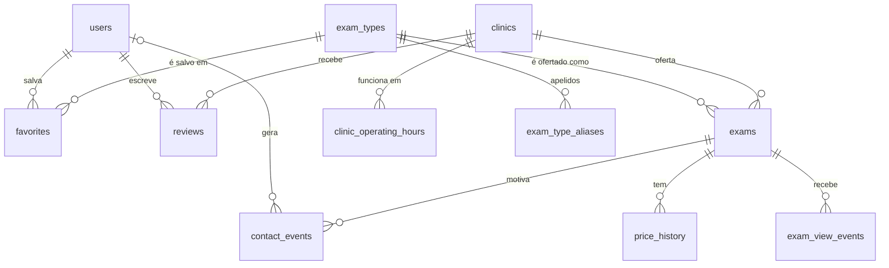

# Clinics Backend

API REST do **Clinics**, aplicativo que compara preços de exames e consultas em clínicas de Surubim-PE e leva o paciente direto ao WhatsApp da clínica escolhida.

> Projeto da disciplina **Programação para Dispositivos Móveis**. Este repositório contém o **back-end**; o aplicativo Flutter fica em um repositório separado (`clinics-mobile`).

## Integrantes

- Márcio Ferreira Lima
- Lucas Nascimento Barros

## O problema

Em cidades pequenas, descobrir quanto cada clínica cobra por um exame exige ligar ou ir de uma em uma. O Clinics reúne os preços, compara lado a lado (com média local, economia, distância e nota) e abre a conversa no WhatsApp da clínica com a mensagem pronta. O app não agenda nem cobra: ele aproxima o paciente da clínica.

## Tecnologias

| Área | Tecnologia |
|---|---|
| Linguagem e framework | Java 25, Spring Boot 4.1 |
| Banco de dados | PostgreSQL 17, migrações com Flyway |
| Segurança | Spring Security, JWT (OAuth2 Resource Server), BCrypt |
| Persistência | Spring Data JPA (escrita) e `JdbcClient` com SQL nativo (consultas) |
| Contrato da API | springdoc-openapi (Swagger UI) |
| Testes | JUnit 5, AssertJ, MockMvc, Testcontainers, ArchUnit |
| Infra local | Docker Compose |

## Arquitetura

Em camadas: **controller → service → repository**.

| Pacote | Responsabilidade |
|---|---|
| `controller` | Endpoints REST: recebem a requisição, validam a entrada e devolvem DTOs |
| `service` | Regras de negócio: cadastro e login, busca e comparação, contatos, gestão da clínica, favoritos, avaliações e economia |
| `repository` | Acesso ao PostgreSQL: SQL com `JdbcClient` nas consultas e Spring Data JPA para usuários |
| `model` | Objetos de negócio (exame, clínica, usuário, avaliação…) e suas validações |
| `dto` | Formatos de entrada e saída da API |
| `config`, `security`, `exception`, `storage` | Configuração, JWT e senhas, tratamento de erros e fotos de perfil |

A direção das dependências é verificada por um teste de arquitetura (ArchUnit): controller só chama service, service só chama repository, e nenhuma camada de baixo conhece a de cima. Detalhes, diagramas de classes e a estrutura de pacotes em [`docs/06-arquitetura-e-classes.md`](docs/06-arquitetura-e-classes.md).

## Como executar

**Pré-requisitos:** JDK 25 e Docker.

```bash
cp .env.example .env            # variáveis locais (o .env não vai para o Git)
docker compose up -d postgres   # só o PostgreSQL na porta 5433
set -a && . ./.env && set +a    # carrega o .env no terminal
./mvnw spring-boot:run          # API em http://localhost:8080

# ou banco + API juntos, em containers:
# docker compose up -d --build
```

As migrações rodam sozinhas na primeira subida e já carregam dados de demonstração de Surubim (6 clínicas, 18 tipos de exame, 31 ofertas e avaliações).

| Endereço | O que é |
|---|---|
| http://localhost:8080/swagger-ui.html | Documentação interativa (use *Authorize* com o token do login) |
| http://localhost:8080/v3/api-docs | Contrato OpenAPI em JSON |
| http://localhost:8080/actuator/health | Health check |

**Testes** (precisam de Docker, pois usam PostgreSQL real via Testcontainers):

```bash
./mvnw test
```

**Variáveis de ambiente (todas opcionais em desenvolvimento):**

| Variável | Padrão | Uso |
|---|---|---|
| `DB_URL` | `jdbc:postgresql://localhost:5433/clinics` | Conexão com o banco |
| `DB_USER`, `DB_PASSWORD` | `clinics` | Credenciais do banco |
| `JWT_SECRET` | valor de desenvolvimento | Chave de assinatura do JWT (mínimo de 32 bytes). **Obrigatório definir em produção.** |
| `AVATARS_DIR` | `./data/avatars` | Pasta das fotos de perfil |
| `PORT` | `8080` | Porta HTTP |

## Casos de uso e endpoints

Base: `/api/v1`. Acesso: 🌐 público, 🔓 token opcional, 🔒 exige token. Exemplos completos em [`docs/07-referencia-da-api.md`](docs/07-referencia-da-api.md).

| UC | Caso de uso | Endpoint | Acesso |
|---|---|---|---|
| UC01 | Cadastrar conta | `POST /auth/register` | 🌐 |
| UC02 | Autenticar | `POST /auth/login` | 🌐 |
| UC03 | Buscar e comparar exames | `GET /exams/search` | 🌐 |
| UC04 | Ver detalhes do exame | `GET /exams/{id}` | 🌐 |
| UC05 | Ver perfil da clínica | `GET /clinics/{id}` | 🌐 |
| UC06 | Ver exames em alta | `GET /exam-types/trending` | 🌐 |
| UC07 | Contatar por WhatsApp | `POST /exams/{id}/contacts` | 🔓 |
| UC08 | Ver economia | `GET /me/savings` | 🔒 |
| UC09 | Favoritar exames | `GET /me/favorites`, `PUT` e `DELETE /me/favorites/{examTypeId}` | 🔒 |
| UC10 | Avaliar clínica | `GET /clinics/{id}/reviews`, `PUT` e `GET /clinics/{id}/reviews/me` | 🌐 / 🔒 |
| UC11 | Gerenciar perfil | `GET` e `PUT /me`, `PUT /me/avatar` | 🔒 |
| UC12 | Alterar senha | `PUT /me/password` | 🔒 |
| — | Painel da clínica | `GET /clinic/me/dashboard` | 🔒 gerente |
| — | Gerenciar exames | `GET/POST /clinic/me/exams`, `PUT/DELETE /clinic/me/exams/{id}` | 🔒 gerente |
| — | Catálogo de exames | `GET /clinic/me/exam-catalog` | 🔒 gerente |

## Banco de dados

Onze tabelas de domínio, versionadas em `src/main/resources/db/migration`: `users`, `clinics`, `clinic_operating_hours`, `exam_types`, `exam_type_aliases`, `exams`, `favorites`, `reviews`, `price_history`, `contact_events` e `exam_view_events`. O diagrama entidade-relacionamento, o dicionário de dados e as decisões de modelagem estão em [`docs/05-modelo-de-dados.md`](docs/05-modelo-de-dados.md).



## Documentação

| Documento | Conteúdo |
|---|---|
| [`01-requisitos.md`](docs/01-requisitos.md) | Requisitos funcionais e não funcionais |
| [`02-historias-de-usuario.md`](docs/02-historias-de-usuario.md) | Histórias de usuário com critérios de aceite |
| [`03-regras-de-negocio.md`](docs/03-regras-de-negocio.md) | Regras de negócio numeradas (RN01 a RN36) |
| [`04-casos-de-uso.md`](docs/04-casos-de-uso.md) | Diagrama e especificação dos casos de uso |
| [`05-modelo-de-dados.md`](docs/05-modelo-de-dados.md) | MER, dicionário de dados e migrações |
| [`06-arquitetura-e-classes.md`](docs/06-arquitetura-e-classes.md) | Arquitetura em camadas e diagramas de classes |
| [`07-referencia-da-api.md`](docs/07-referencia-da-api.md) | Endpoints com exemplos reais e catálogo de erros |
| [`08-diagramas-de-sequencia.md`](docs/08-diagramas-de-sequencia.md) | Fluxos principais de ponta a ponta |

## Convenções do projeto

- Código em inglês; mensagens ao usuário em português (pt-BR).
- JSON em `snake_case`; erros no formato RFC 9457 com um `code` estável.
- Commits no padrão Conventional Commits, em português, curtos e objetivos.
- Regras de negócio com identificador (`RN..`) para rastrear documento, código e teste.

## Status

**Entrega 2:** os casos de uso do paciente estão implementados e testados.

**Gestão da clínica:** painel com contagens dos últimos 30 dias e cadastro/edição/desativação de ofertas estão implementados para contas `CLINIC_MANAGER`. A conta deve ser vinculada manualmente a uma clínica por `clinics.owner_user_id`; o cadastro público continua criando apenas pacientes.

**Evoluções planejadas:** recuperar senha, histórico de buscas, consentimento LGPD, exportar e excluir dados e refresh token.
