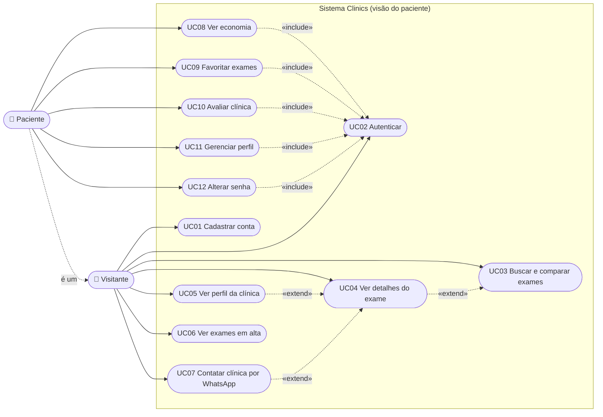
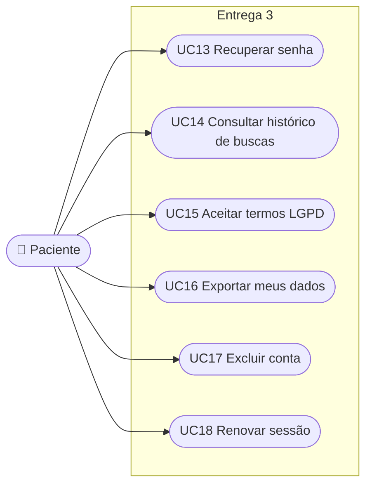

# 04 · Casos de Uso

## 1. Diagrama

O Mermaid não tem diagrama UML de casos de uso nativo. Usamos um `flowchart` com atores à esquerda e casos de uso como elipses, mantendo a semântica (`include` e `extend` como setas tracejadas).

*Leitura:* o paciente é um visitante que se autenticou, por isso herda tudo que o visitante faz. Os casos de uso que exigem identidade incluem UC02.

## 2. Casos de uso previstos para a Entrega 3

## 3. Especificação resumida

| UC | Nome | Ator | Pré-condição | Fluxo principal | Fluxos alternativos | Regras | Endpoint |
|---|---|---|---|---|---|---|---|
| UC01 | Cadastrar conta | Visitante | Telefone não cadastrado | Informa nome, telefone e senha → valida → cria `PATIENT` → devolve token | Telefone duplicado (409); dados inválidos (400) | RN01–RN05 | `POST /api/v1/auth/register` |
| UC02 | Autenticar | Visitante | Conta existente | Informa telefone e senha → valida → devolve JWT | Credenciais inválidas (401) | RN06, RN07 | `POST /api/v1/auth/login` |
| UC03 | Buscar e comparar exames | Visitante | – | Informa termo, categoria e ordenação → recebe página de ofertas com média, economia e distância | Sem resultados (lista vazia); `distance` sem `lat/lng` (400) | RN12, RN14–RN21 | `GET /api/v1/exams/search` |
| UC04 | Ver detalhes do exame | Visitante | Oferta existe e está disponível | Seleciona oferta → recebe dados da oferta e da clínica | Oferta inexistente (404) | RN22 | `GET /api/v1/exams/{id}` |
| UC05 | Ver perfil da clínica | Visitante | Clínica existe | Seleciona clínica → recebe perfil, horários e ofertas | Clínica inexistente (404) | RN22 | `GET /api/v1/clinics/{id}` |
| UC06 | Ver exames em alta | Visitante | – | Abre a home → recebe o ranking da semana | Poucos dados → completa por menor preço | RN30 | `GET /api/v1/exam-types/trending` |
| UC07 | Contatar clínica por WhatsApp | Visitante | Oferta disponível | Toca no botão → registra contato → recebe o link | Oferta inexistente (404) | RN28, RN29 | `POST /api/v1/exams/{id}/contacts` |
| UC08 | Ver economia | Paciente | Autenticado | Abre perfil → recebe o total economizado | – | RN31 | `GET /api/v1/me/savings` |
| UC09 | Favoritar exames | Paciente | Autenticado | Favorita um tipo de exame; pode listar e remover | Já favoritado (idempotente) | RN23 | `PUT/DELETE /api/v1/me/favorites/{examTypeId}`, `GET /api/v1/me/favorites` |
| UC10 | Avaliar clínica | Paciente | Autenticado | Envia nota e comentário → salva → recalcula a média | Nota inválida (400); reavaliação substitui | RN25–RN27 | `PUT /api/v1/clinics/{id}/reviews/me`, `GET /api/v1/clinics/{id}/reviews` |
| UC11 | Gerenciar perfil | Paciente | Autenticado | Consulta e edita dados; envia foto | Dados inválidos (400) | RN32–RN36 | `GET/PUT /api/v1/me`, `PUT /api/v1/me/avatar` |
| UC12 | Alterar senha | Paciente | Autenticado | Informa senha atual e nova → troca | Senha atual errada (400) | RN03, RN08 | `PUT /api/v1/me/password` |

## 4. Matriz de rastreabilidade

| Caso de uso | Requisitos | Histórias | Regras |
|---|---|---|---|
| UC01 | RF01 | HU01 | RN01–RN05 |
| UC02 | RF02 | HU02 | RN06–RN07 |
| UC03 | RF03, RF04, RF14 | HU03, HU04, HU14 | RN12, RN14–RN21 |
| UC04 | RF05 | HU05 | RN22 |
| UC05 | RF06 | HU06 | RN22 |
| UC06 | RF07 | HU07 | RN30 |
| UC07 | RF10, RF17 | HU08, HU17 | RN28–RN29 |
| UC08 | RF11 | HU09 | RN31 |
| UC09 | RF08, RF13, RF17 | HU10, HU17 | RN23 |
| UC10 | RF09 | HU11 | RN25–RN27 |
| UC11 | RF12, RF16 | HU12, HU16 | RN32–RN36 |
| UC12 | RF12 | HU13 | RN03, RN08 |

> O reconhecimento por voz (HU15, RF15) é um recurso do app que alimenta o UC03 e não exige endpoint próprio.
