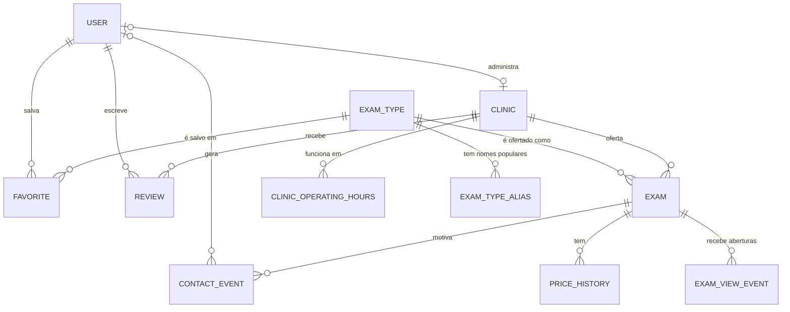
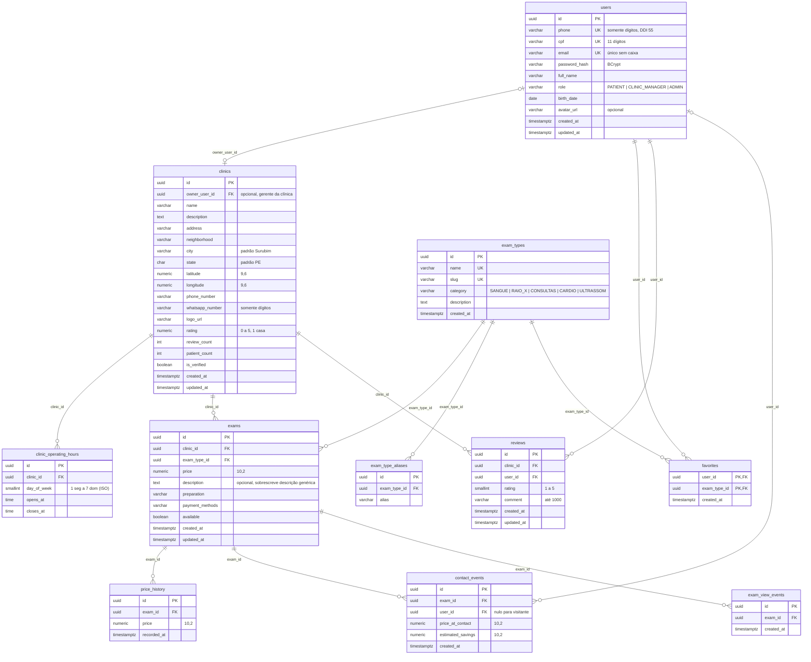

# 05 · Modelo de Dados (MER)

Este documento é a base das migrações Flyway. **Nenhuma tabela é criada sem estar aqui.**

## 1. Decisões de modelagem

| # | Decisão | Motivo |
|---|---|---|
| D1 | **Catálogo `exam_types` separado da oferta `exams`.** | A comparação exige saber que "Hemograma" da clínica A e "Hemograma Completo" da clínica B são o mesmo exame. Comparar por texto livre quebra com qualquer variação de grafia. Com o catálogo, a busca agrupa por tipo e a média local é exata (RN09, RN14). |
| D2 | **`favorites` aponta para `exam_types`.** | O paciente quer acompanhar "o menor preço de Hemograma", não uma oferta específica (RN23). |
| D3 | **Horários em `clinic_operating_hours`** (um intervalo por dia da semana). | Permite calcular "aberto agora" e "atende hoje" (RN22). Um texto livre não permite. |
| D4 | **`price_history` registra cada mudança de preço.** | Base do gráfico de evolução e do alerta de queda. Tabela *append-only*. |
| D5 | **`contact_events` guarda `price_at_contact` e `estimated_savings`.** | A economia é um fato histórico. Se o preço mudar depois, o total economizado não pode mudar. |
| D6 | **Desnormalização controlada** de `clinics.rating` e `clinics.review_count`. | A listagem lê a nota em toda busca; recalcular por `AVG()` a cada leitura é caro. Mantida na mesma transação da avaliação (RN27). |
| D7 | **Chaves primárias UUID** geradas pelo banco. | Não expõe contagem de registros nem permite adivinhar ids sequenciais (reduz risco de IDOR). |
| D8 | **Dinheiro em `NUMERIC(10,2)`**, nunca `FLOAT`. | Evita erro de arredondamento binário (RN11). |
| D9 | **Datas em `TIMESTAMPTZ` (UTC).** A conversão para `America/Recife` é feita na aplicação. | Evita ambiguidade de fuso e horário de verão. |
| D10 | **Enums como `VARCHAR` + `CHECK`**, não tipo `ENUM` do PostgreSQL. | Alterar `ENUM` exige migração mais invasiva; `CHECK` troca com um `ALTER`. |
| D11 | **Distância calculada com Haversine em SQL**, sem PostGIS. | Para ≤ 5 mil ofertas em uma cidade, o custo é irrelevante. PostGIS fica como evolução se houver escala regional. |
| D12 | **Sem exclusão física de avaliações e contatos de usuários**: `ON DELETE SET NULL` em `contact_events.user_id`. | Preserva métricas agregadas após a exclusão de conta (RF20). |
| D13 | **Tabela de refresh token fica para a Entrega 3.** | A sessão de 1 h basta para a Entrega 2. |
| D14 | **A oferta pode substituir a descrição genérica do catálogo.** | Cada clínica apresenta a descrição do seu próprio serviço sem quebrar a comparação por tipo de exame. |
| D15 | **Aberturas de detalhes ficam em `exam_view_events`.** | Permite medir visualizações anônimas e autenticadas por clínica sem contar consultas da busca como abertura. |

## 2. Modelo conceitual

Entidades e relacionamentos, sem atributos.



**Cardinalidades:**
- Um usuário favorita vários tipos de exame, e um tipo é favoritado por vários usuários (N:N resolvido por `favorites`).
- Uma clínica tem várias ofertas; cada oferta pertence a uma clínica e a um tipo de exame.
- Um usuário avalia uma clínica no máximo uma vez (N:N com restrição de unicidade em `reviews`).
- Um contato pode ser anônimo (`user_id` nulo, para visitantes).
- `USER |o--o| CLINIC` é o vínculo opcional do gerente com uma única clínica, usado na autorização das rotas de gestão.

## 3. Modelo lógico



## 4. Restrições e índices

| Tabela | Restrição / índice | Para quê |
|---|---|---|
| `users` | `UNIQUE (phone)` | RN01 |
| `users` | `UNIQUE (lower(email)) WHERE email IS NOT NULL` | RN04 |
| `users` | `UNIQUE (cpf) WHERE cpf IS NOT NULL` | RN37 |
| `users` | `CHECK (role IN ('PATIENT','CLINIC_MANAGER','ADMIN'))` | RN05 |
| `clinics` | `CHECK (rating BETWEEN 0 AND 5)` | Integridade |
| `clinics` | `owner_user_id` com `ON DELETE SET NULL` | Excluir o gestor não apaga a clínica |
| `clinics` | índice único parcial em `owner_user_id` | Um gerente administra no máximo uma clínica |
| `clinic_operating_hours` | `UNIQUE (clinic_id, day_of_week, opens_at)`, `CHECK (day_of_week BETWEEN 1 AND 7)`, `CHECK (closes_at > opens_at)` | RN22 |
| `exam_types` | `UNIQUE (slug)`, `UNIQUE (name)`, `CHECK (category IN (...))` | RN09, RN10 |
| `exams` | `UNIQUE (clinic_id, exam_type_id)` | RN09 |
| `exams` | `CHECK (price >= 0)` | RN11 |
| `exams` | índice `(exam_type_id, price) WHERE available` | Comparação por tipo ordenada por preço |
| `exams` | índice `(clinic_id)` | Ofertas de uma clínica |
| `favorites` | PK `(user_id, exam_type_id)` | RN23: idempotência e unicidade |
| `reviews` | `UNIQUE (user_id, clinic_id)`, `CHECK (rating BETWEEN 1 AND 5)` | RN25, RN26 |
| `reviews` | índice `(clinic_id, created_at DESC)` | Listagem de avaliações |
| `price_history` | índice `(exam_id, recorded_at DESC)` | Gráfico e último preço |
| `contact_events` | índice `(created_at DESC)` e `(exam_id, created_at DESC)` | Ranking da semana |
| `contact_events` | índice `(user_id)` | Total economizado |
| `exam_view_events` | índice `(exam_id, created_at DESC)` | Contagem de aberturas por clínica e período |

**Extensões:** `unaccent` (busca sem acento, RN16) e `pgcrypto` ou `gen_random_uuid()` nativo (PostgreSQL ≥ 13).

## 5. Dicionário de dados

### `users`
| Coluna | Tipo | Nulo | Observação |
|---|---|---|---|
| id | uuid | não | PK, `gen_random_uuid()` |
| phone | varchar(13) | não | `5581998765432` |
| cpf | varchar(11) | sim | só dígitos; obrigatório no cadastro (nulo apenas nos dados de demonstração) |
| email | varchar(255) | sim | |
| password_hash | varchar(100) | não | BCrypt |
| full_name | varchar(120) | não | |
| role | varchar(20) | não | padrão `PATIENT` |
| birth_date | date | sim | não pode ser futura |
| avatar_url | varchar(500) | sim | |
| created_at, updated_at | timestamptz | não | `now()` |

### `clinics`
| Coluna | Tipo | Nulo | Observação |
|---|---|---|---|
| id | uuid | não | PK |
| owner_user_id | uuid | sim | FK `users` |
| name | varchar(150) | não | |
| description | text | sim | |
| address, neighborhood | varchar | não, sim | |
| city, state | varchar, char(2) | não | padrão Surubim, PE |
| latitude, longitude | numeric(9,6) | sim | usados na distância |
| phone_number | varchar(20) | sim | |
| whatsapp_number | varchar(15) | não | só dígitos |
| logo_url | varchar(500) | sim | |
| rating | numeric(2,1) | não | padrão 0 |
| review_count, patient_count | int | não | padrão 0 |
| is_verified | boolean | não | padrão false |

### `exam_types` e `exams`
| Coluna | Tipo | Nulo | Observação |
|---|---|---|---|
| exam_types.name | varchar(150) | não | Ex.: "Ultrassom Abdominal Total" |
| exam_types.slug | varchar(150) | não | `ultrassom-abdominal-total` |
| exam_types.category | varchar(20) | não | enum |
| exam_types.description | text | sim | explicação genérica do procedimento |
| exams.price | numeric(10,2) | não | |
| exams.description | text | sim | descrição da oferta; quando nula, usa `exam_types.description` |
| exams.preparation | varchar(255) | sim | "Jejum 8h • Laudo em 24h" |
| exams.payment_methods | varchar(255) | sim | |
| exams.available | boolean | não | padrão true |

## 6. Consultas críticas

**Comparação de um exame (UC03):** ofertas do tipo, com média e distância.

```sql
SELECT e.id, c.name, e.price,
       AVG(e.price) OVER () AS avg_price,
       6371 * 2 * ASIN(SQRT(
         POWER(SIN(RADIANS(c.latitude - :lat) / 2), 2) +
         COS(RADIANS(:lat)) * COS(RADIANS(c.latitude)) *
         POWER(SIN(RADIANS(c.longitude - :lng) / 2), 2))) AS distance_km
FROM exams e JOIN clinics c ON c.id = e.clinic_id
WHERE e.exam_type_id = :type AND e.available
ORDER BY e.price;
```

**Em alta (UC06):** contatos dos últimos 7 dias por tipo.

```sql
SELECT t.id, t.name, COUNT(*) AS contacts, MIN(e.price) AS min_price
FROM contact_events ce
JOIN exams e ON e.id = ce.exam_id
JOIN exam_types t ON t.id = e.exam_type_id
WHERE ce.created_at >= now() - interval '7 days'
GROUP BY t.id, t.name ORDER BY contacts DESC LIMIT 5;
```

## 7. Normalização

O modelo está na **3ª forma normal**, com uma desnormalização deliberada (D6). Atributos da oferta (`price`, `preparation`) dependem da chave `(clinic, tipo)`, e atributos do tipo (`name`, `category`) dependem só do tipo, o que elimina a repetição do nome do exame em cada clínica.

## 8. Migrações implementadas

| Versão | Arquivo | Conteúdo |
|---|---|---|
| V1 | `V1__create_users.sql` | Extensão `unaccent`, tabela `users`, índice único de e-mail sem caixa |
| V2 | `V2__create_clinics.sql` | `clinics`, `clinic_operating_hours` |
| V3 | `V3__create_exam_types_and_exams.sql` | `exam_types`, `exams` (oferta) e índices de comparação |
| V4 | `V4__create_engagement_tables.sql` | `favorites`, `reviews`, `price_history`, `contact_events` |
| V5 | `V5__seed_demo_data.sql` | 6 clínicas, horários, 18 tipos de exame, 31 ofertas, histórico de preço e contatos de exemplo |
| V6 | `V6__seed_demo_reviews.sql` | 5 pacientes de demonstração (sem login) e 21 avaliações; recalcula `rating` e `review_count` das clínicas |
| V7 | `V7__add_cpf_to_users.sql` | Coluna `cpf` e índice único parcial |
| V8 | `V8__surubim_demo_clinics.sql` | Clínicas de demonstração ambientadas em Surubim, com nomes e bairros alterados |
| V9 | `V9__exam_type_aliases.sql` | Tabela `exam_type_aliases` com os nomes populares dos exames |
| V10 | `V10__clinic_management_and_exam_views.sql` | Descrição por oferta, vínculo único de gerente e eventos de abertura dos detalhes |

O banco tem **11 tabelas de domínio**: `users`, `clinics`, `clinic_operating_hours`, `exam_types`, `exam_type_aliases`, `exams`, `favorites`, `reviews`, `price_history`, `contact_events` e `exam_view_events`. As aberturas são eventos por requisição bem-sucedida a `GET /exams/{id}`, não usuários únicos; contatos são contados por solicitação de redirecionamento ao WhatsApp.

`price_history` recebe uma linha por oferta no seed e uma nova linha quando a clínica altera o preço.

## 9. Tabelas futuras

`refresh_tokens`, `password_reset_tokens`, `search_history`, `consents`.
