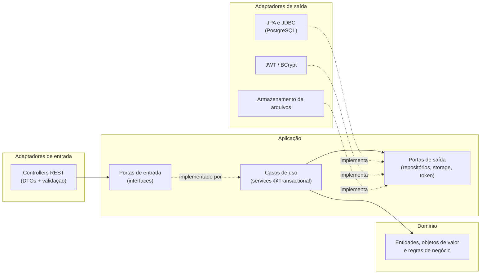
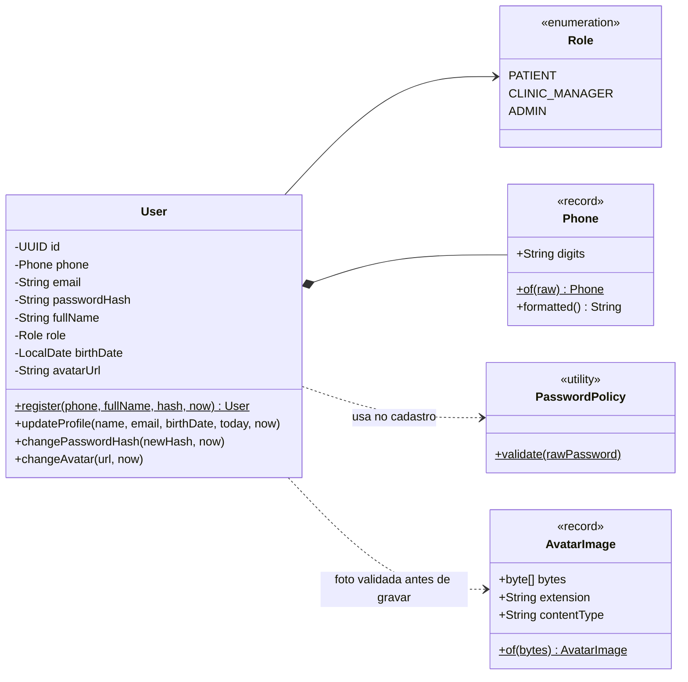
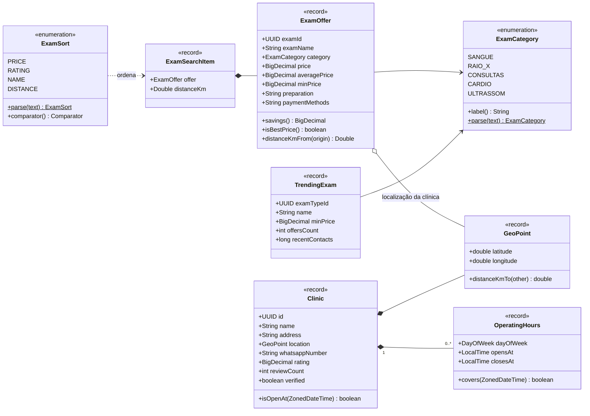
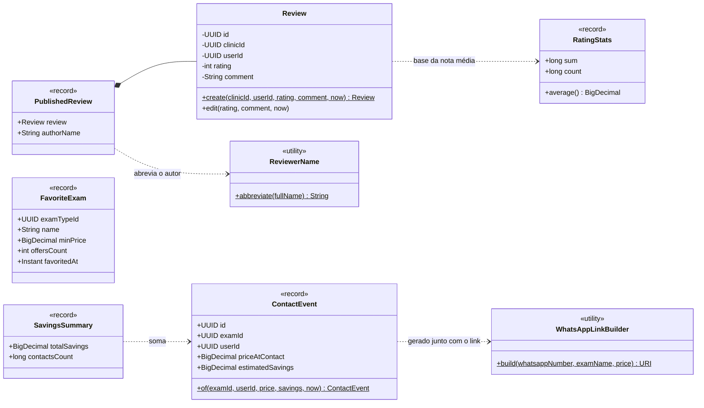
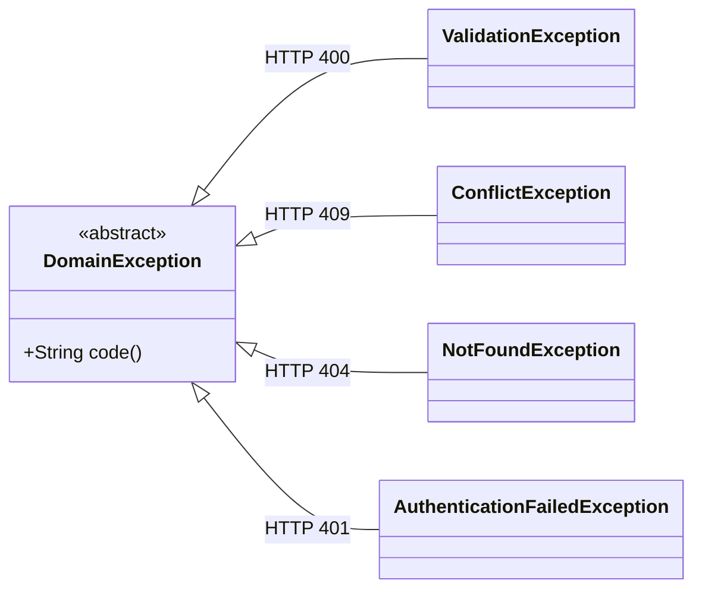
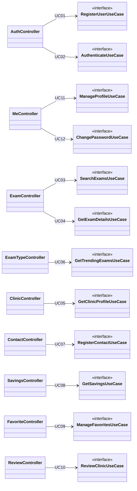

# 06 · Arquitetura e Diagrama de Classes

## 1. Estilo arquitetural

**Arquitetura hexagonal (portas e adaptadores), organizada por funcionalidade** (*package by feature*). O domínio não depende de Spring, JPA nem HTTP; as dependências apontam sempre para dentro.



**Por que esta arquitetura:** as regras de negócio (RN14, RN15, RN19, RN22, RN27, RN28) ficam em classes puras, testáveis sem subir o Spring; trocar o armazenamento de fotos (disco → S3) afeta só um adaptador.

### Estrutura de pacotes (como está no código)

```
br.com.clinics
├── shared/
│   ├── domain/                   # DomainException e subtipos, PageResult
│   └── infrastructure/
│       ├── web/                  #   GlobalExceptionHandler (RFC 9457), FieldNames
│       ├── openapi/              #   OpenApiConfig, SnakeCaseModelConverter
│       └── ClockConfig           #   Clock injetável (fuso America/Recife)
├── identity/                     # UC01, UC02, UC11, UC12
│   ├── domain/                   #   User, Phone, Role, PasswordPolicy, AvatarImage
│   ├── application/              #   RegisterUser, Authenticate, ManageProfile, ChangePassword
│   │   └── port/{in,out}/        #   UserRepository, PasswordHasher, TokenIssuer, AvatarStorage
│   └── infrastructure/
│       ├── persistence/          #   UserJpaEntity, SpringDataUserRepository, UserPersistenceAdapter
│       ├── security/             #   SecurityConfig, JwtTokenIssuer, BcryptPasswordHasher, JwtProperties
│       ├── storage/              #   LocalAvatarStorage, StaticFilesConfig
│       └── web/                  #   AuthController, MeController, DTOs
├── catalog/                      # UC03, UC04, UC05, UC06
│   ├── domain/                   #   ExamOffer, Clinic, OperatingHours, GeoPoint, ExamCategory, ExamSort, TrendingExam
│   ├── application/              #   SearchExams, GetExamDetails, GetClinicProfile, GetTrendingExams
│   └── infrastructure/
│       ├── persistence/          #   consultas SQL (JdbcClient): ExamOffer, Clinic, Trending
│       └── web/                  #   ExamController, ExamTypeController, ClinicController
├── engagement/                   # UC07, UC08, UC09, UC10
│   ├── domain/                   #   Review, RatingStats, ReviewerName, ContactEvent, WhatsAppLinkBuilder, ...
│   ├── application/              #   RegisterContact, GetSavings, ManageFavorites, ReviewClinic
│   └── infrastructure/
│       ├── persistence/          #   JDBC + CatalogContactableExamLookup (adaptador anticorrupção)
│       └── web/                  #   ContactController, SavingsController, FavoriteController, ReviewController
└── ClinicsBackendApplication
```

**Regras de dependência**, verificadas automaticamente por `ArchitectureTest` (ArchUnit):
1. `domain` não importa Spring, JPA, Hibernate nem Jackson.
2. `domain` não depende de `application` nem de `infrastructure`.
3. `application` não depende de `infrastructure`.

**Comunicação entre módulos:** `engagement` precisa de dados de uma oferta, mas não importa as classes do catálogo. Ele define a própria porta de saída (`ContactableExamLookup`) e o adaptador `CatalogContactableExamLookup` chama a porta pública `GetExamDetailsUseCase` do catálogo, traduzindo para o vocabulário do `engagement`. Consultas de leitura que cruzam tabelas de módulos diferentes (ex.: "em alta" lê `contact_events`) usam SQL direto, como modelos de leitura.

## 2. Diagrama de classes do domínio

O diagrama mostra as classes que existem no código, agrupadas por módulo.

> **Diferenças em relação ao modelo conceitual do MER (doc 05):** no catálogo, `ExamType` + `Exam` aparecem unidos como o objeto de leitura `ExamOffer`, porque a Entrega 2 só lê o catálogo (a escrita de ofertas pertence à visão da clínica, fora do escopo). `PriceHistory` existe como tabela, mas não tem classe de domínio enquanto nada altera preços. Valores monetários usam `BigDecimal` direto.

### 2.1. Módulo `identity`



### 2.2. Módulo `catalog`



### 2.3. Módulo `engagement`



### 2.4. Exceções de domínio



O `GlobalExceptionHandler` converte cada subtipo em `application/problem+json` com o `code` da exceção.

## 3. Casos de uso e controllers



## 4. Decisões técnicas e bibliotecas

| Preocupação | Escolha | Justificativa |
|---|---|---|
| Framework | Spring Boot 4.1.1, Java 25 | Plataforma do curso; Java 25 é LTS |
| Persistência de escrita | Spring Data JPA + Hibernate | Padrão de mercado para agregados simples (`users`) |
| Consultas de leitura | `JdbcClient` com SQL nativo | Funções de janela (média e mínimo por exame), `unaccent`, agregações; JPQL não expressa isso bem |
| Migrações | Flyway | Esquema versionado e reprodutível; Hibernate só valida (`ddl-auto=validate`) |
| JWT | Spring Security OAuth2 Resource Server (Nimbus) | Validação mantida pelo Spring Security, sem biblioteca extra |
| Senhas | `BCryptPasswordEncoder`, custo 10 | RNF01 |
| Validação | Jakarta Bean Validation + regras no domínio | Formato nos DTOs; regras de negócio nas entidades |
| DTOs | `record` do Java | Imutáveis e concisos |
| Documentação da API | springdoc-openapi 3.1 | Swagger UI e contrato em `/v3/api-docs` |
| Erros | `ProblemDetail` (RFC 9457) + `@RestControllerAdvice` | RNF07 |
| Testes | JUnit 5, AssertJ, MockMvc, Testcontainers, ArchUnit | RNF08 |
| Observabilidade | Actuator (`/actuator/health`) | Health check para o deploy |
| Infra local | Docker Compose (PostgreSQL 17) | RNF10 |

### Por que JPA e JDBC juntos
`users` é um agregado pequeno com ciclo de vida de criação e edição, bem atendido por JPA. As consultas do catálogo e do engajamento são de leitura, agregam entre tabelas e usam recursos do PostgreSQL; escrevê-las em SQL deixa a intenção explícita e evita projeções JPA artificiais. Ambas ficam atrás de portas de saída, então o restante do sistema não sabe qual tecnologia é usada.

## 5. Estratégia de testes

| Nível | O que cobre | Ferramenta |
|---|---|---|
| Unidade | Regras de negócio puras (RN03, RN14, RN15, RN19, RN22, RN25–RN28, RN34) | JUnit 5 + AssertJ, sem Spring |
| Integração | Cada endpoint com a aplicação completa e PostgreSQL real | `@SpringBootTest` + MockMvc + Testcontainers |
| Arquitetura | Regras de dependência entre camadas | ArchUnit |
| Contrato | Endpoints presentes no OpenAPI e nomes em `snake_case` | MockMvc em `/v3/api-docs` |

Os testes de integração criam os próprios usuários com telefone aleatório e, quando alteram o seed, restauram o estado ao final.
