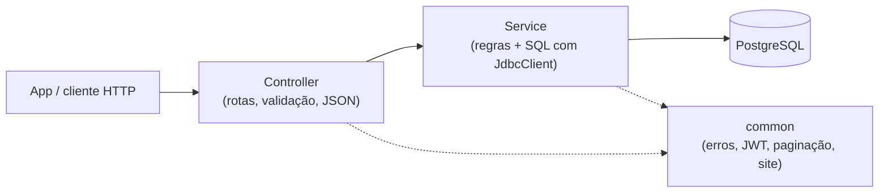

# 06 · Arquitetura

## 1. Estilo arquitetural

**Pacotes por funcionalidade, cada um com um controller e um service.** O controller recebe o HTTP, valida a entrada (Bean Validation) e devolve `record`s em JSON. O service guarda as regras de negócio e fala direto com o PostgreSQL por SQL (`JdbcClient`). Não há camada de repositório, entidades JPA nem DTOs intermediários: o volume de regras do Clinics é pequeno e o SQL já expressa a maior parte delas.



## 2. Pacotes

```
br.com.clinics
├── ClinicsBackendApplication.java
├── common/        ApiException, ErrorHandler (RFC 9457), Page, SecurityConfig (JWT e regras de acesso),
│                  WebConfig (site, PWA, avatares, APK e relógio), OpenApiConfig (Swagger em snake_case)
├── user/          UserController, UserService       cadastro, login, perfil, foto e senha
├── catalog/       CatalogController, CatalogService busca, detalhes, contato pelo WhatsApp, em alta,
│                  Category                          perfil da clínica e bairros
├── engagement/    EngagementController,             favoritos, economia e avaliações
│                  EngagementService
└── clinicadmin/   ClinicAdminController,            painel do gestor da clínica
                   ClinicAdminService
```

Cada pacote se lê de cima para baixo: o controller mostra as rotas e o formato do JSON; o service mostra as regras e as consultas.

## 3. Rotas por controller

| Controller | Rotas | UC |
|---|---|---|
| `UserController` | `POST /auth/register`, `POST /auth/login`, `GET/PUT /me`, `PUT /me/avatar`, `PUT /me/password` | UC01, UC02, UC11, UC12 |
| `CatalogController` | `GET /exams/search`, `GET /exams/{id}`, `POST /exams/{id}/contacts`, `GET /exam-types/trending`, `GET /clinics/{id}`, `GET /neighborhoods` | UC03 a UC07 |
| `EngagementController` | `PUT/DELETE /me/favorites/{examTypeId}`, `GET /me/favorites`, `GET /me/savings`, `GET /clinics/{id}/reviews`, `GET/PUT /clinics/{id}/reviews/me` | UC08 a UC10 |
| `ClinicAdminController` | `GET /clinic/me/dashboard`, `GET /clinic/me/exam-catalog`, `GET/POST /clinic/me/exams`, `PUT/DELETE /clinic/me/exams/{id}` | gestão da clínica |
| `WebConfig` | `/`, `/app/`, `/docs`, `/files/avatars/**`, `/download/clinics.apk` | site e download |

Todas as rotas da API ficam sob `/api/v1`. A referência completa está em `07-referencia-da-api.md`.

## 4. Onde estão as regras

| Regra | Onde |
|---|---|
| Telefone, CPF, senha, e-mail, data de nascimento, foto (RN01–RN03, RN32–RN34, RN37) | `UserService` (seção "regras de formato") |
| Login sem revelar se o telefone existe (RN06) e JWT com `sub`, `role` e `exp` (RN07) | `UserService.login` e `issueToken` |
| Média, menor preço, economia e selo "Melhor preço" (RN14, RN15) | SQL `OFFERS` e record `Offer` em `CatalogService` |
| Busca sem acento e por apelido (RN16, RN39), filtros, ordenação e paginação (RN17, RN21) | `CatalogService.search` |
| Distância (RN19) e "aberta agora" (RN22) | `Offer.distanceKm` e `Clinic.openAt` |
| Link do WhatsApp e economia congelada no contato (RN28, RN31) | `CatalogService.contact` |
| Em alta: 7 dias, até 5 itens (RN30) | `CatalogService.trending` |
| Avaliação única por paciente e clínica, nota da clínica atualizada na mesma transação (RN25–RN27) | `EngagementService.submitReview` |
| Nome abreviado do autor nas avaliações (LGPD) | `EngagementService.abbreviate` |
| Gestor só altera ofertas da própria clínica; histórico de preço | `ClinicAdminService` |
| Quem acessa o quê (público, paciente, gestor) | `SecurityConfig` |

## 5. Decisões técnicas

| Preocupação | Escolha | Por quê |
|---|---|---|
| Framework | Spring Boot 4.1, Java 25 | Plataforma do curso; Java 25 é LTS |
| Acesso a dados | `JdbcClient` com SQL nativo | Funções de janela, `unaccent` e agregações do PostgreSQL; um jeito só de falar com o banco |
| Migrações | Flyway | Esquema versionado; o código não cria nem altera tabelas |
| JWT | Spring Security OAuth2 Resource Server (Nimbus), HS256 | Validação mantida pelo Spring, sem biblioteca extra |
| Senhas | BCrypt, custo 10 | RNF01 |
| Erros | `ProblemDetail` (RFC 9457) com `code` estável | RNF07; o app trata pelo `code` |
| JSON | `snake_case` global no Jackson | Contrato combinado com o app |
| Documentação da API | springdoc-openapi | Swagger UI em `/docs` e contrato em `/v3/api-docs` |
| Testes | JUnit 5, MockMvc, Testcontainers | Testes pela API com PostgreSQL real |

## 6. Testes

Os testes exercitam a API de fora, como o app faz: `@SpringBootTest` + MockMvc + PostgreSQL real (Testcontainers). Não há testes de unidade de classes internas; as regras são verificadas pelo comportamento dos endpoints. Detalhes em `10-testes-e-rastreabilidade.md`.

## 7. Histórico

- Começou com arquitetura hexagonal por módulos.
- Em outubro de 2026 virou camadas (controller → service → repository, com ArchUnit).
- Em 27/10/2026 foi reescrito no formato atual, mais simples: de 100 para 16 arquivos Java (de ~3.900 para ~2.000 linhas), sem JPA, sem camada de repositório e sem testes de arquitetura. O contrato da API (rotas, JSON e códigos de erro) não mudou: os mesmos testes de integração passam nas duas versões. O código anterior está na branch `legado` e na tag `legado-2026-10-27`.
