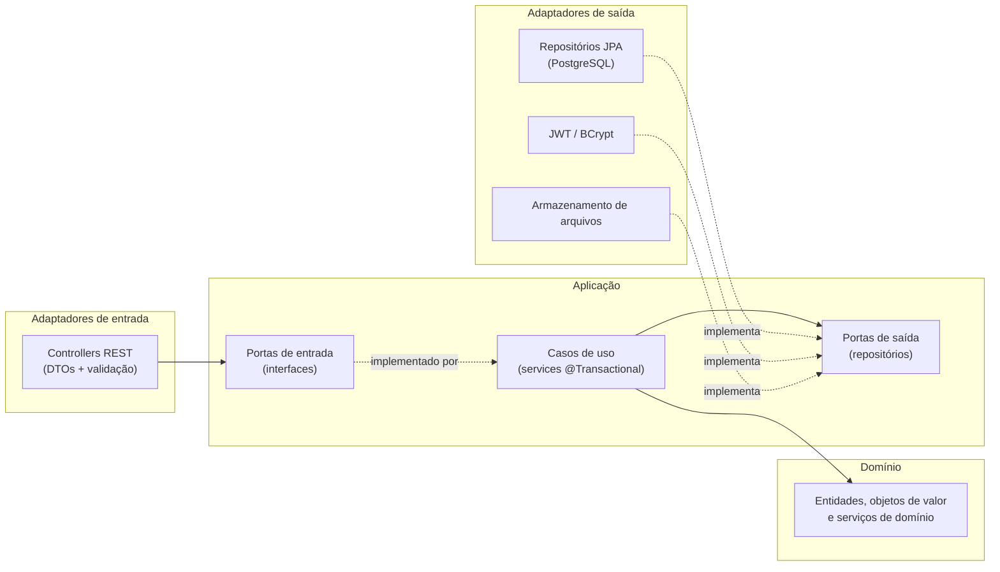
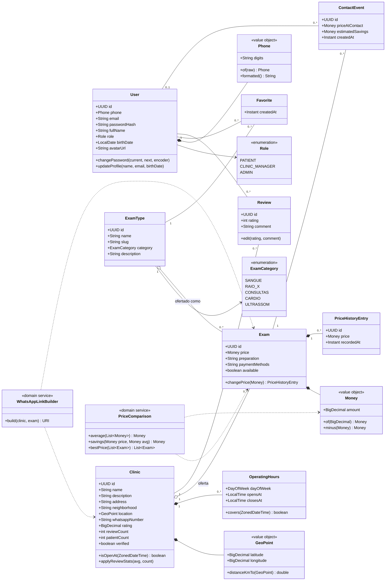

# 06 · Arquitetura e Diagrama de Classes

## 1. Estilo arquitetural

**Arquitetura hexagonal (portas e adaptadores), organizada por funcionalidade** (*package by feature*). O domínio não depende de Spring, JPA nem HTTP; as dependências apontam sempre para dentro.



**Por que esta arquitetura:** regras de negócio (RN14, RN15, RN19, RN22, RN28) ficam em classes puras e testáveis sem subir o Spring; trocar o armazenamento de fotos (disco → S3) afeta só um adaptador.

### Estrutura de pacotes

```
br.com.clinics
├── shared/                       # exceções de domínio, ProblemDetail, paginação, relógio (Clock)
├── identity/                     # UC01, UC02, UC11, UC12
│   ├── domain/                   #   User, Role, Phone, ...
│   ├── application/              #   RegisterUser, Authenticate, UpdateProfile, ChangePassword
│   │   └── port/{in,out}/
│   └── infrastructure/
│       ├── web/                  #   AuthController, MeController, DTOs
│       ├── persistence/          #   UserJpaEntity, SpringDataUserRepository, mapper
│       └── security/             #   JwtService, SecurityConfig
├── catalog/                      # UC03, UC04, UC05, UC06
│   ├── domain/                   #   Clinic, ExamType, Exam, OperatingHours, PriceComparison, GeoPoint
│   ├── application/
│   └── infrastructure/
├── engagement/                   # UC07, UC08, UC09, UC10
│   ├── domain/                   #   Favorite, Review, ContactEvent, WhatsAppLink
│   ├── application/
│   └── infrastructure/
└── ClinicsBackendApplication
```

**Regras de dependência (verificadas por teste ArchUnit):**
1. `domain` não importa nada de `application`, `infrastructure`, Spring ou JPA.
2. `application` só conhece `domain` e as próprias portas.
3. Um módulo não acessa as classes JPA de outro. A comunicação é por portas.

## 2. Diagrama de classes do domínio



**Associações:** composição (`*--`) para partes que não existem sem o todo (`OperatingHours`, `PriceHistoryEntry`); agregação (`o--`) para ofertas, que pertencem à clínica mas têm ciclo de vida próprio.

## 3. Diagrama de componentes dos casos de uso

```mermaid
classDiagram
    direction TB
    class AuthController
    class MeController
    class ExamController
    class ClinicController
    class EngagementController

    class RegisterUserUseCase { <<interface>> }
    class AuthenticateUseCase { <<interface>> }
    class SearchExamsUseCase { <<interface>> }
    class GetExamDetailsUseCase { <<interface>> }
    class GetClinicProfileUseCase { <<interface>> }
    class GetTrendingExamsUseCase { <<interface>> }
    class RegisterContactUseCase { <<interface>> }
    class ManageFavoritesUseCase { <<interface>> }
    class ReviewClinicUseCase { <<interface>> }
    class ManageProfileUseCase { <<interface>> }

    AuthController --> RegisterUserUseCase
    AuthController --> AuthenticateUseCase
    MeController --> ManageProfileUseCase
    MeController --> ManageFavoritesUseCase
    ExamController --> SearchExamsUseCase
    ExamController --> GetExamDetailsUseCase
    ExamController --> GetTrendingExamsUseCase
    ExamController --> RegisterContactUseCase
    ClinicController --> GetClinicProfileUseCase
    EngagementController --> ReviewClinicUseCase
```



## 4. Decisões técnicas e bibliotecas

| Preocupação | Escolha | Justificativa |
|---|---|---|
| Framework | Spring Boot 4.1.1, Java 25 | Plataforma-alvo do curso; Java 25 é LTS |
| Persistência | Spring Data JPA + Hibernate | Padrão de mercado; consultas complexas via JPQL ou SQL nativo |
| Migrações | Flyway | Esquema versionado e reprodutível (RNF05) |
| JWT | Spring Security OAuth2 Resource Server (Nimbus) | Validação mantida pelo Spring Security; evita biblioteca extra e superfície de ataque |
| Senhas | BCrypt (`BCryptPasswordEncoder`, custo 10) | RNF01 |
| Validação | Jakarta Bean Validation | Validação declarativa nos DTOs |
| Mapeamento | Conversores manuais (mappers) entre JPA, domínio e DTO | Sem mágica de reflexão e fácil de testar. MapStruct é opção se o volume crescer |
| DTOs | `record` do Java | Imutáveis e concisos |
| Documentação da API | springdoc-openapi | RNF06 |
| Erros | `ProblemDetail` (RFC 9457) + `@RestControllerAdvice` | RNF07 |
| Testes | JUnit 5, AssertJ, Mockito, Testcontainers, ArchUnit | RNF08 e regras de dependência |
| Observabilidade | Actuator (`/health`, `/info`) | Health check para deploy |

## 5. Estratégia de testes

| Nível | O que cobre | Ferramenta |
|---|---|---|
| Unidade | Regras de negócio puras (RN14, RN15, RN19, RN22, RN28) | JUnit + AssertJ, sem Spring |
| Aplicação | Casos de uso com portas simuladas | Mockito |
| Integração | Repositórios e consultas com PostgreSQL real | Testcontainers |
| Web | Controllers, segurança, validação e formato de erro | `MockMvc` |
| Arquitetura | Regras de dependência entre camadas | ArchUnit |
