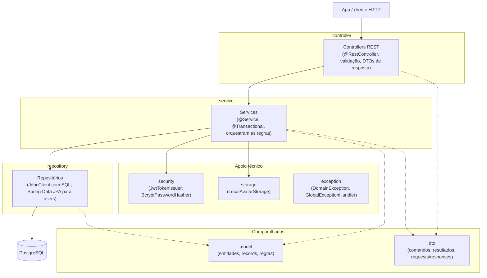
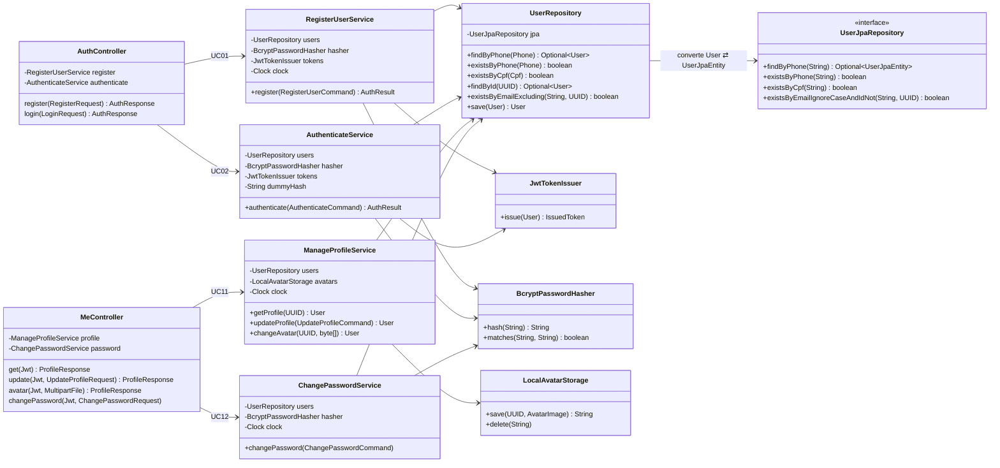
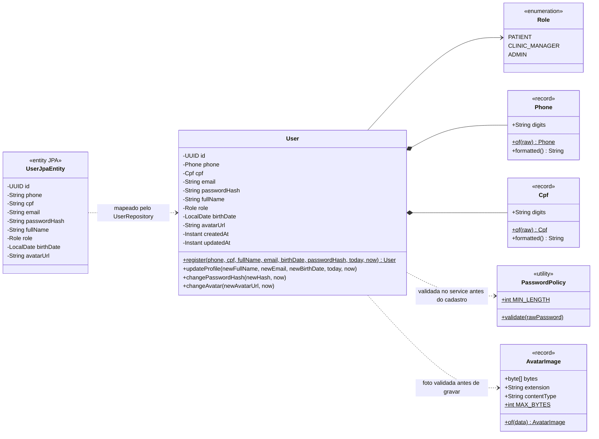
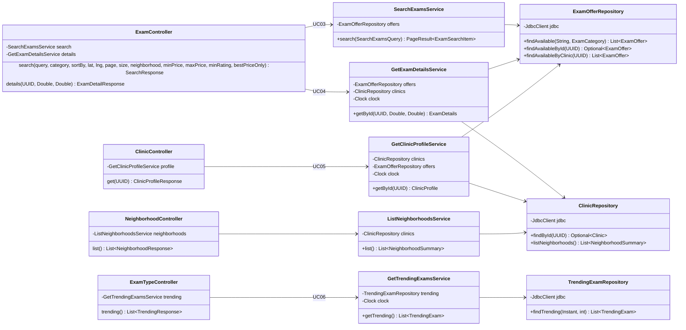
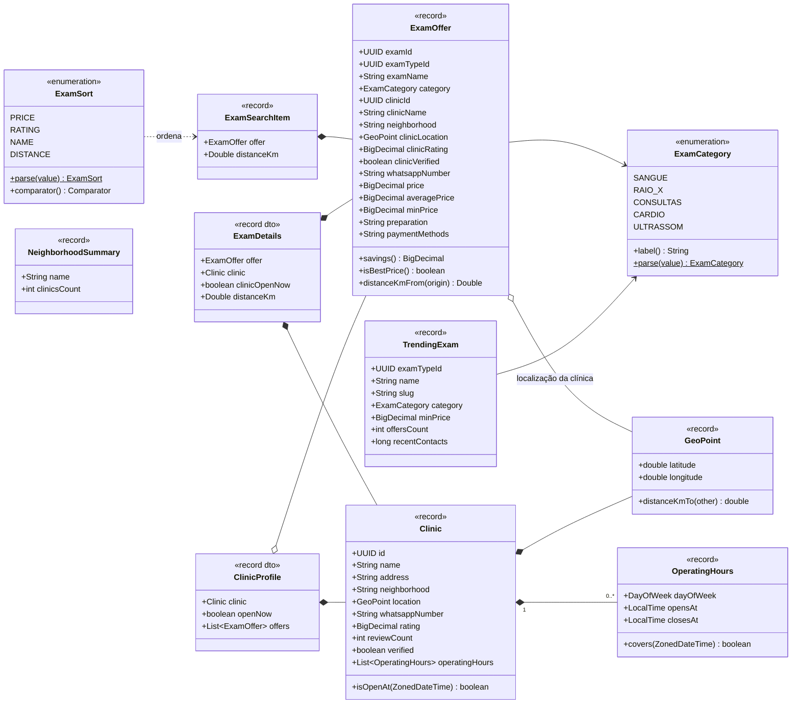
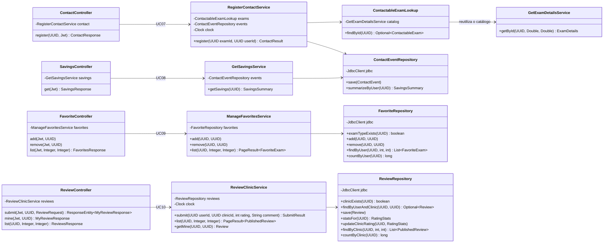
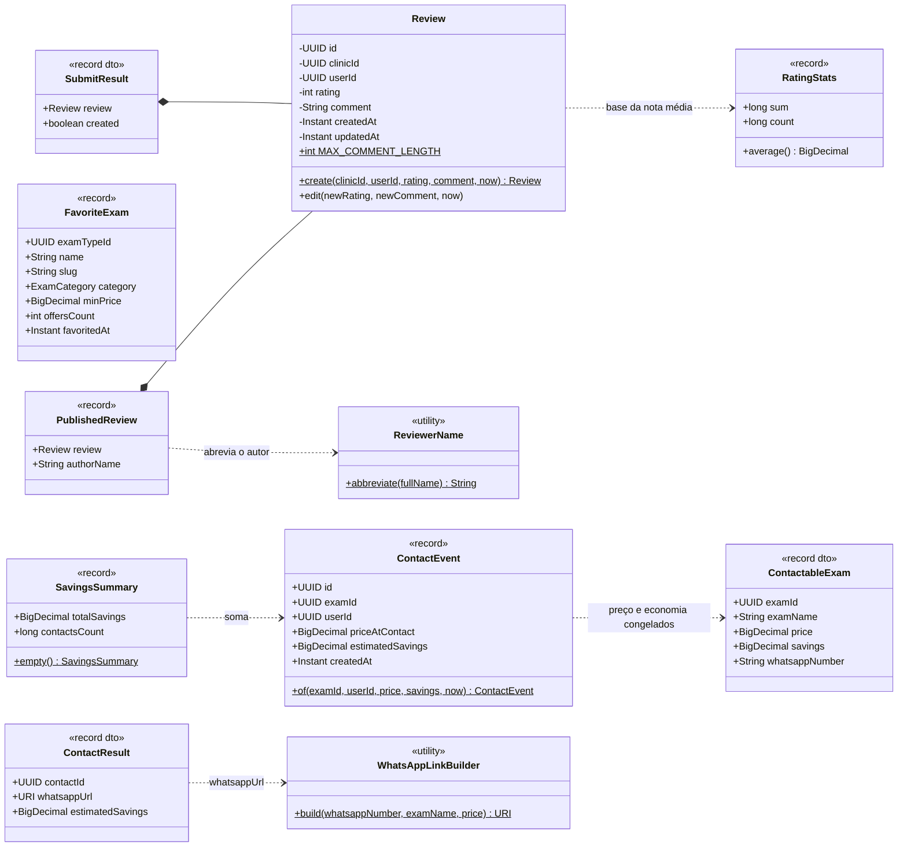
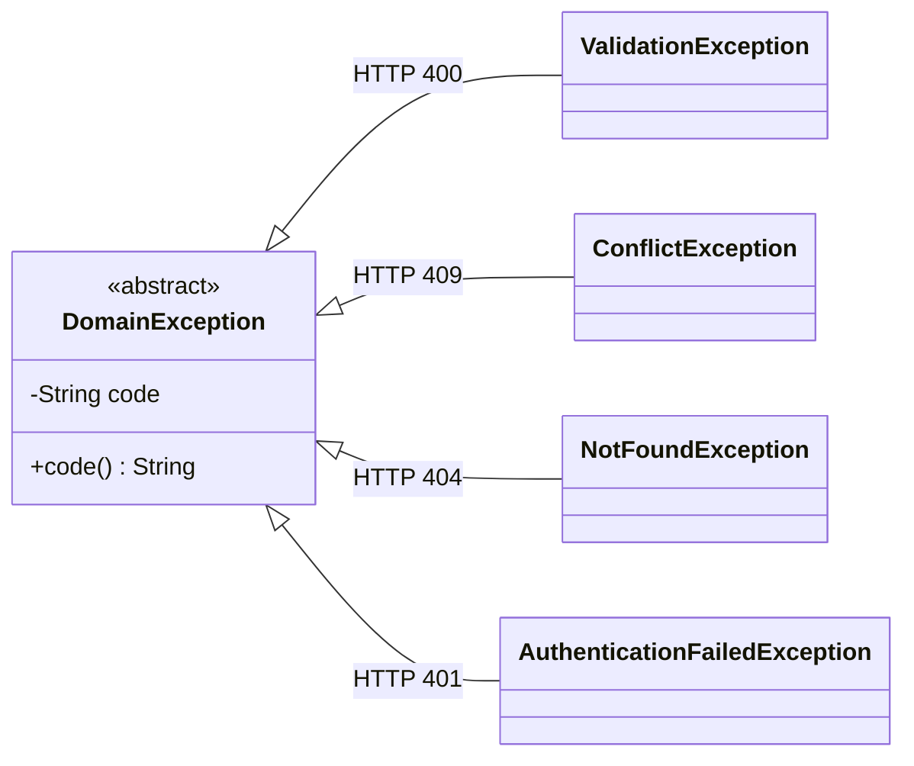

# 06 · Arquitetura e Diagrama de Classes

## 1. Estilo arquitetural

**Arquitetura em camadas** (*layered*): cada requisição desce por `controller` → `service` → `repository`, e nunca sobe. As classes de `model` (entidades, objetos de valor e regras de negócio) e de `dto` (comandos e resultados) são compartilhadas pelas camadas.



- **controller**: recebe HTTP, aplica Bean Validation, extrai o id do usuário do JWT e converte o resultado do service em DTO de resposta.
- **service**: uma classe por funcionalidade (`RegisterUserService`, `SearchExamsService`, ...). Define a transação e chama as regras de `model`.
- **repository**: acesso ao banco. Só é chamado por services.
- **model**: regras de negócio puras (ex.: `Phone.of`, `Review.create`, `RatingStats.average`), sem dependência de controller, service ou repository.

### 1.1. Estrutura de pacotes (como está no código)

```
br.com.clinics
├── ClinicsBackendApplication
├── config/           # ClockConfig (fuso America/Recife), JwtProperties, OpenApiConfig,
│                     #   SiteConfig, SnakeCaseModelConverter, StaticFilesConfig, StorageProperties
├── controller/       # AppDownloadController, AuthController, ClinicController, ContactController,
│                     #   ExamController, ExamTypeController, FavoriteController, MeController,
│                     #   NeighborhoodController, ReviewController, SavingsController, FieldNames
├── dto/              # AuthDtos, ExamDtos, ProfileDtos (requests/responses);
│                     #   AuthenticateCommand, ChangePasswordCommand, RegisterUserCommand,
│                     #   UpdateProfileCommand, SearchExamsQuery; AuthResult, ClinicProfile,
│                     #   ContactableExam, ContactResult, ExamDetails, IssuedToken, PageResult, SubmitResult
├── exception/        # DomainException, AuthenticationFailedException, ConflictException,
│                     #   NotFoundException, ValidationException, GlobalExceptionHandler (RFC 9457)
├── model/            # AvatarImage, Clinic, ContactEvent, Cpf, ExamCategory, ExamOffer, ExamSearchItem,
│                     #   ExamSort, FavoriteExam, GeoPoint, NeighborhoodSummary, OperatingHours,
│                     #   PasswordPolicy, Phone, PublishedReview, RatingStats, Review, ReviewerName,
│                     #   Role, SavingsSummary, TrendingExam, User, UserJpaEntity, WhatsAppLinkBuilder
├── repository/       # ClinicRepository, ContactEventRepository, ExamOfferRepository, FavoriteRepository,
│                     #   ReviewRepository, TrendingExamRepository, UserRepository, UserJpaRepository
├── security/         # SecurityConfig, JwtTokenIssuer, BcryptPasswordHasher, ProblemDetailSecurityHandler
├── service/          # AuthenticateService, ChangePasswordService, ContactableExamLookup,
│                     #   GetClinicProfileService, GetExamDetailsService, GetSavingsService,
│                     #   GetTrendingExamsService, ListNeighborhoodsService, ManageFavoritesService,
│                     #   ManageProfileService, RegisterContactService, RegisterUserService,
│                     #   ReviewClinicService, SearchExamsService, Paging
└── storage/          # LocalAvatarStorage
```

### 1.2. Por que camadas

O backend tem poucas regras de negócio: a maior parte das funcionalidades é ler o catálogo, gravar um contato, uma avaliação ou um favorito, e editar o perfil. Para esse tamanho, camadas são mais simples de navegar e de manter: há um pacote por papel técnico, o caminho de uma requisição é sempre o mesmo e não há interfaces com uma única implementação. As regras que existem continuam em `model`, testáveis sem subir o Spring. A direção das dependências é garantida pelo ArchUnit, então a simplicidade não vira acoplamento.

### 1.3. Regras verificadas pelo ArchUnit

`src/test/java/br/com/clinics/ArchitectureTest.java` falha o build se alguma destas regras for quebrada:

1. **Camadas** (`layeredArchitecture`, considerando só dependências entre as camadas):
   - `controller` não é acessado por nenhuma camada;
   - `service` só é acessado por `controller` e pelo próprio `service`;
   - `repository` só é acessado por `service`.
2. `model` não depende de `controller`, `service` nem `repository`.
3. Não existem mais pacotes `port`, `application`, `infrastructure` ou `domain`.
4. Classes `*Controller` ficam em `controller`; `*Service` em `service`; `*Repository` em `repository`.

### 1.4. Comunicação entre áreas

O registro de contato (engajamento) precisa de dados de uma oferta do catálogo. Em vez de ler as tabelas do catálogo de novo, `ContactableExamLookup` (pacote `service`) reutiliza `GetExamDetailsService.getById` e devolve só o que o contato usa: o record `ContactableExam` (id, nome, preço, economia e WhatsApp). Consultas de leitura que cruzam tabelas de áreas diferentes (ex.: "em alta" lê `contact_events`) usam SQL direto no repositório.

## 2. Diagramas de classes

Os diagramas mostram as classes que existem no código, agrupadas por área funcional. Em cada área há um diagrama das camadas (controller → service → repository) e um do `model`. Os métodos dos controllers são package-private; acessores, construtores e alguns campos descritivos (ex.: `description`, `city`, `logoUrl` em `Clinic`) foram omitidos para legibilidade.

> **Diferenças em relação ao modelo conceitual do MER (doc 05):** no catálogo, `ExamType` + `Exam` aparecem unidos como o objeto de leitura `ExamOffer`, porque a Entrega 2 só lê o catálogo (a escrita de ofertas pertence à visão da clínica, fora do escopo). `PriceHistory` existe como tabela, mas não tem classe em `model` enquanto nada altera preços. Valores monetários usam `BigDecimal` direto.

### 2.1. Identidade (cadastro, login e perfil)





### 2.2. Catálogo (busca, detalhes, clínica, bairros e em alta)





### 2.3. Engajamento (contato, economia, favoritos e avaliações)





### 2.4. Exceções



O `GlobalExceptionHandler` converte cada subtipo em `application/problem+json` com o `code` da exceção. Erros 401 e 403 do Spring Security saem no mesmo formato pelo `ProblemDetailSecurityHandler`.

## 3. Controllers e services

| Controller | Service | UC (doc de requisitos) |
|---|---|---|
| `AuthController` | `RegisterUserService`, `AuthenticateService` | UC01, UC02 |
| `MeController` | `ManageProfileService`, `ChangePasswordService` | UC11, UC12 |
| `ExamController` | `SearchExamsService`, `GetExamDetailsService` | UC03, UC04 |
| `ClinicController` | `GetClinicProfileService` | UC05 |
| `ExamTypeController` | `GetTrendingExamsService` | UC06 |
| `NeighborhoodController` | `ListNeighborhoodsService` | filtro de bairros da busca |
| `ContactController` | `RegisterContactService` | UC07 |
| `SavingsController` | `GetSavingsService` | UC08 |
| `FavoriteController` | `ManageFavoritesService` | UC09 |
| `ReviewController` | `ReviewClinicService` | UC10 |
| `AppDownloadController` | (nenhum; lê o APK do disco) | download do app Android |

## 4. Decisões técnicas e bibliotecas

| Preocupação | Escolha | Justificativa |
|---|---|---|
| Framework | Spring Boot 4.1.1, Java 25 | Plataforma do curso; Java 25 é LTS |
| Persistência de escrita | Spring Data JPA + Hibernate | Padrão de mercado para agregados simples (`users`) |
| Consultas de leitura | `JdbcClient` com SQL nativo | Funções de janela (média e mínimo por exame), `unaccent`, agregações; JPQL não expressa isso bem |
| Migrações | Flyway | Esquema versionado e reprodutível; Hibernate só valida (`ddl-auto=validate`) |
| JWT | Spring Security OAuth2 Resource Server (Nimbus) | Validação mantida pelo Spring Security, sem biblioteca extra |
| Senhas | `BCryptPasswordEncoder`, custo 10 | RNF01 |
| Validação | Jakarta Bean Validation + regras em `model` | Formato nos DTOs; regras de negócio nas classes de `model` |
| DTOs | `record` do Java | Imutáveis e concisos |
| Documentação da API | springdoc-openapi 3.1 | Swagger UI e contrato em `/v3/api-docs` |
| Erros | `ProblemDetail` (RFC 9457) + `@RestControllerAdvice` | RNF07 |
| Testes | JUnit 5, AssertJ, MockMvc, Testcontainers, ArchUnit | RNF08 |
| Observabilidade | Actuator (`/actuator/health`) | Health check para o deploy |
| Infra local | Docker Compose (PostgreSQL 17) | RNF10 |

### Por que JPA e JDBC juntos
`users` é um agregado pequeno com ciclo de vida de criação e edição, bem atendido por JPA: `UserRepository` usa o `UserJpaRepository` (Spring Data) e converte `UserJpaEntity` em `User`, então os services nunca veem a entidade JPA. As consultas do catálogo e do engajamento são de leitura, agregam entre tabelas e usam recursos do PostgreSQL; escrevê-las em SQL (`JdbcClient`) deixa a intenção explícita e evita projeções JPA artificiais. Os services só conhecem as classes `*Repository`, não a tecnologia por trás delas.

## 5. Estratégia de testes

| Nível | O que cobre | Ferramenta |
|---|---|---|
| Unidade | Regras de negócio puras em `model` (RN03, RN14, RN15, RN19, RN22, RN25–RN28, RN34) | JUnit 5 + AssertJ, sem Spring |
| Integração | Cada endpoint com a aplicação completa e PostgreSQL real | `@SpringBootTest` + MockMvc + Testcontainers |
| Arquitetura | Direção controller → service → repository e nomes das classes (seção 1.3) | ArchUnit |
| Contrato | Endpoints presentes no OpenAPI e nomes em `snake_case` | MockMvc em `/v3/api-docs` |

Os testes de integração criam os próprios usuários com telefone aleatório e, quando alteram o seed, restauram o estado ao final.

## 6. Histórico

O projeto começou com arquitetura hexagonal organizada por módulos. Em outubro de 2026 foi migrado para camadas, para simplificar a navegação e a manutenção. O contrato da API (rotas, JSON e códigos de erro) não mudou.
