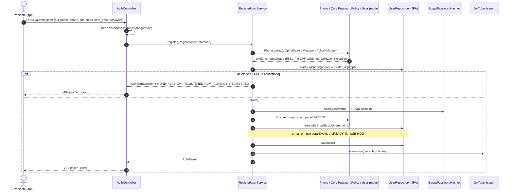
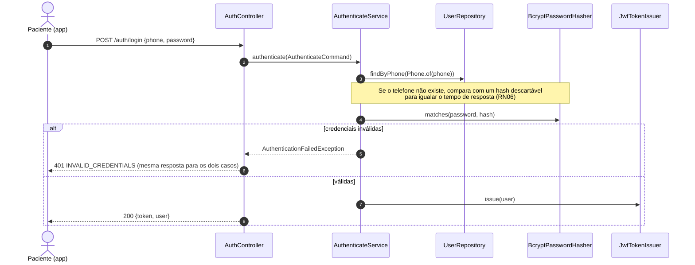
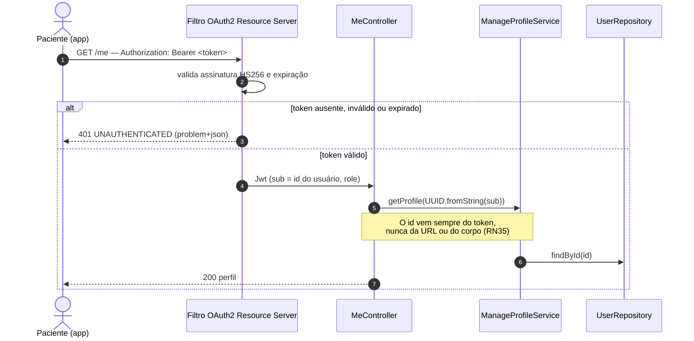
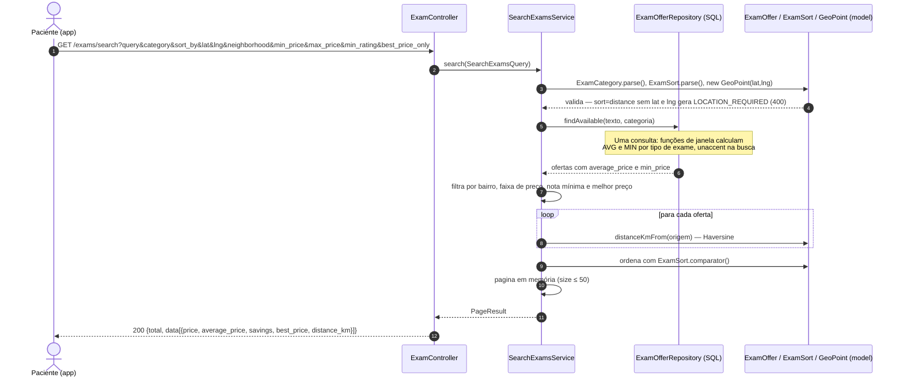
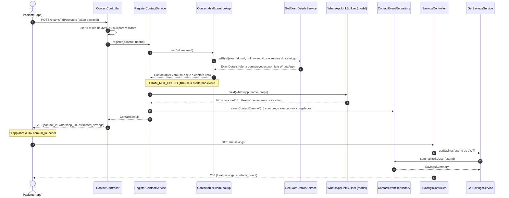
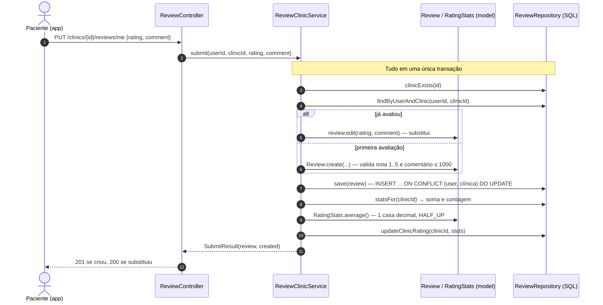
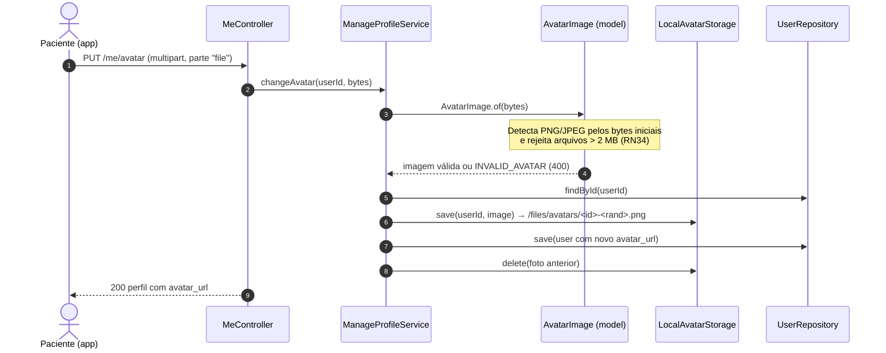

# 08 · Diagramas de Sequência

Os fluxos abaixo mostram como uma requisição atravessa as camadas (`controller` → `service` → `repository`), com as regras de negócio nas classes de `model`. Cada diagrama corresponde ao código real; os nomes dos participantes são as classes em `src/main/java/br/com/clinics`.

## 1. Cadastro e login (UC01, UC02)

## 2. Acesso a uma rota protegida (JWT)

## 3. Buscar e comparar exames (UC03)

## 4. Contato por WhatsApp e economia (UC07, UC08)

## 5. Avaliar clínica (UC10)

## 6. Atualizar foto de perfil (UC11)

