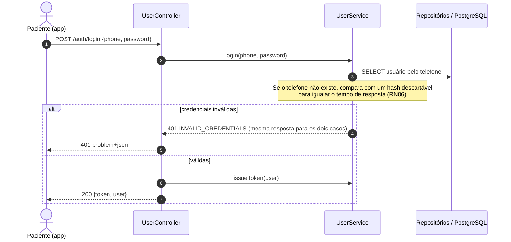
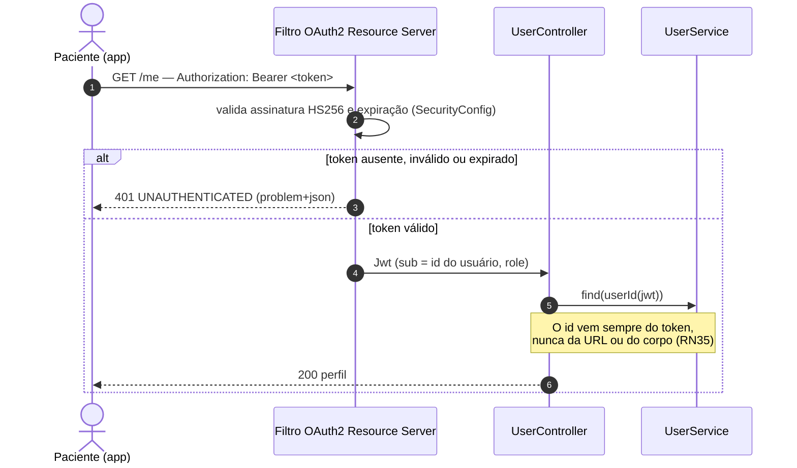
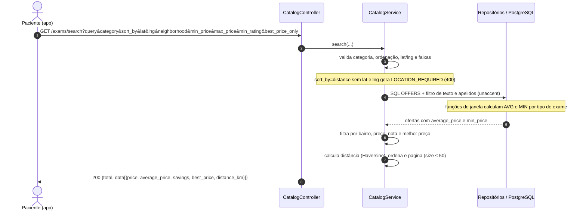
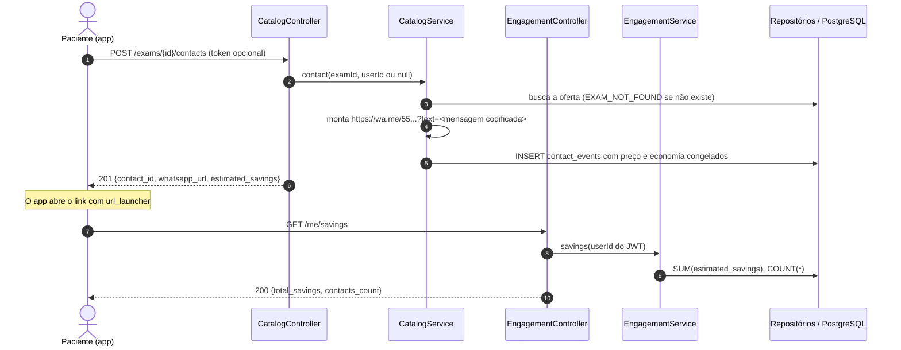
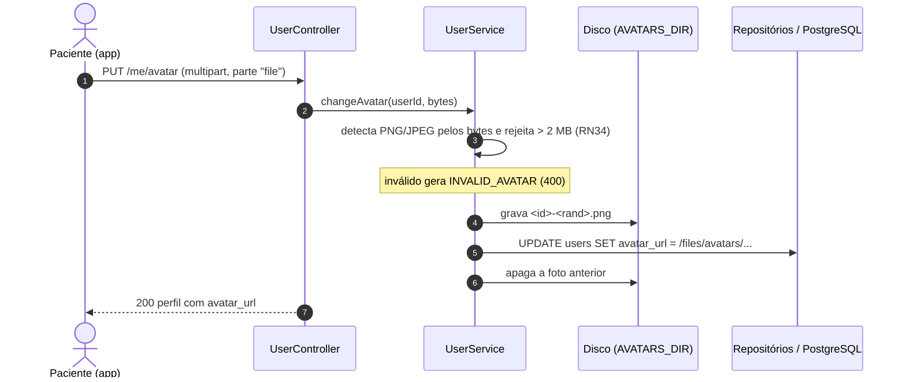

# 08 · Diagramas de Sequência

Os fluxos abaixo mostram como uma requisição passa pelo controller e pelo service do pacote correspondente até o PostgreSQL. O service chega ao banco sempre pelos repositórios Spring Data JPA, representados em um único participante. Os participantes são as classes em `src/main/java/br/com/clinics`.

## 1. Cadastro e login (UC01, UC02)

```mermaid
sequenceDiagram
    autonumber
    actor P as Paciente (app)
    participant C as UserController
    participant S as UserService
    participant DB as Repositórios / PostgreSQL

    P->>C: POST /auth/register {full_name, phone, cpf, email, birth_date, password}
    C->>C: Bean Validation (campos obrigatórios)
    C->>S: register(...)
    S->>S: parsePhone, parseCpf, validatePassword
    Note over S: telefone vira 5581..., CPF só dígitos;<br/>formato inválido gera 400 (INVALID_PHONE, INVALID_CPF, WEAK_PASSWORD)
    S->>DB: telefone ou CPF já existem?
    alt já cadastrado
        S-->>C: 409 PHONE_ALREADY_REGISTERED / CPF_ALREADY_REGISTERED
        C-->>P: 409 problem+json
    else livres
        S->>S: valida nome, e-mail e nascimento
        S->>DB: e-mail em uso? (409 EMAIL_ALREADY_IN_USE)
        S->>DB: INSERT users (senha com BCrypt custo 10, papel PATIENT)
        C->>S: issueToken(user) — sub, role, exp
        C-->>P: 201 {token, user}
    end
```



## 2. Acesso a uma rota protegida (JWT)



## 3. Buscar e comparar exames (UC03)



## 4. Contato por WhatsApp e economia (UC07, UC08)



## 5. Avaliar clínica (UC10)

```mermaid
sequenceDiagram
    autonumber
    actor P as Paciente (app)
    participant C as EngagementController
    participant S as EngagementService
    participant DB as Repositórios / PostgreSQL

    P->>C: PUT /clinics/{id}/reviews/me {rating, comment}
    C->>S: submitReview(userId, clinicId, rating, comment)
    Note over S,DB: Tudo em uma única transação
    S->>DB: a clínica existe? (CLINIC_NOT_FOUND)
    S->>S: nota 1..5 e comentário ≤ 1000
    S->>DB: já existe avaliação deste paciente?
    S->>DB: grava a avaliação (nova ou editada; UNIQUE por usuário e clínica)
    S->>DB: atualiza clinics: rating = média com 1 casa, review_count
    C-->>P: 201 se criou, 200 se substituiu
```

## 6. Atualizar foto de perfil (UC11)


